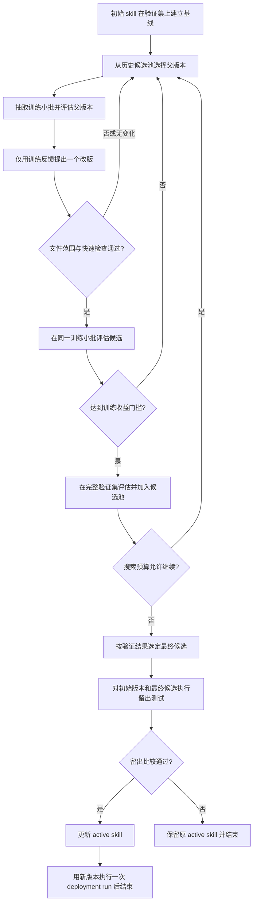

# 基于任务反馈的 skill 搜索

本仓提供可选的 `optimizer.strategy: "pareto"`，在已有长任务服务上增加任务集、训练反馈、历史候选池、父版本选择和最终留出验证。不配置 `optimizer` 时，原有单候选 circle 流程保持不变。

这是参考 GEPA/gskill 机制实现的本地优化器，使用 Python 标准库；没有调用上游 `gepa` 包，也没有复刻全部 gskill 功能。gskill 的参考价值包括可验证任务、执行反馈驱动的反思，以及训练/验证/测试分离；本版不生成 SWE-smith 任务，不做候选交叉合并。[gskill 官方指南](https://gepa-ai.github.io/gepa/guides/gskill/)

## 运行本地演示

```bash
cd /Users/cx/code/RSI/rsi
python3 -m rsi_service serve --config examples/search/demo.json
python3 -m rsi_service status --config examples/search/demo.json
python3 -m rsi_service events --config examples/search/demo.json
```

演示中的 skill 把两类可恢复故障默认判为停止。独立 fixture 执行器读取 skill 中的规则，逐任务测量实际分类结果；改进器只根据训练反馈，每轮增加一条规则。验证和测试使用不同的故障记录，并包含不能退化的致命错误案例。

演示不使用 Codex、网络、模型权重或 NPU。它证明调度、搜索与证据门禁可以运行，不证明真实 Day0 的改进有效。运行完成后状态留在 `examples/search/.state/`；重新执行会读取已有终态。需要新实验时复制配置并使用新的状态目录。

停止、接管、取消和异常恢复沿用 [服务说明](SERVICE.md) 中的命令。长时间无日志不会触发空闲超时；设置 `RSI_DEMO_EVAL_SECONDS=20` 可在本地观察长评估期间的停止与接管。

## 搜索与生效版本分开管理



历史候选不必成为生产版本才能继续参与搜索。一个候选可能只在某类案例上更好，暂时不能通过发布门禁，但仍能成为后续改进的父版本。`active_version` 在搜索期间保持原值；只有最终候选通过独立留出比较后才切换，随后执行一次使用新版本的实际任务。

本版按验证样例维护“该样例上得分最高的候选集合”，候选成为多少个样例的最优者，就获得相应选择权重。平分也保留。这是 GEPA 文档中的逐 key 选择方式，不等同于收集所有数学意义上的非支配解；在任何样例上都不是最好、但整体较均衡的候选可能不会被选作父版本。[候选选择机制](https://gepa-ai.github.io/gepa/guides/candidate-selection/)

训练批次按固定 seed 进行分轮打乱与抽样。父版本和改版必须评估同一批任务，避免用不同难度的批次制造收益。抽样用于降低提案阶段的评估量；它不会免除后续验证。[GEPA 批采样参考](https://gepa-ai.github.io/gepa/guides/batch-sampling/)

## 配置与任务集

在已有服务配置中增加：

```json
{
  "optimizer": {
    "strategy": "pareto",
    "dataset": "./tasks.json",
    "seed": 42,
    "train_batch_size": 2,
    "max_metric_calls": 60,
    "max_full_evaluations": 8,
    "min_train_gain": 0.01
  }
}
```

任务文件包含三个非空集合：

```json
{
  "train": [
    {"id": "train-a", "task": "修复训练案例中的初始化失败", "input": {"case_manifest": "/path/train-a.json"}}
  ],
  "validation": [
    {"id": "val-a", "task": "验证另一组初始化案例", "input": {"case_manifest": "/path/val-a.json"}}
  ],
  "test": [
    {"id": "test-a", "task": "执行最终留出验收", "input": {"case_manifest": "/path/test-a.json"}}
  ]
}
```

每个任务需要唯一的 `id` 和非空 `task`，`input` 可放 JSON 数据。ID 在三个集合中不能重复；相同任务文本与输入不能复制到不同集合。语义近似、同一故障的轻微改写、相同模型或代码来源导致的泄漏，仍需任务设计者审查。

任务文件自动参与验证输入指纹，整个搜索实验固定这一身份。检查器、数据或其他已声明输入在实验期间变化会阻断搜索，不能混用前后结果。改变实验配置需使用新的 `state_dir`，已有预算不会因重启而重置。

## 执行与反馈接口

搜索模式由 `steps.evaluate` 统一负责“执行指定 skill 和任务，再独立判分”。它应是操作员审核过的命令；真实 Day0 harness 可在其中调用 Codex CLI，然后检查真实 tracker、门禁产物和测量结果。`steps.improve` 可以使用现有 Codex 适配器。`steps.run` 只在最终候选通过留出验收后调用一次，执行顶层 `task` 并使用新的 active 快照；搜索过程不会在每个评估之前额外调用一次完整 Day0。

评估上下文新增：

| 字段 | 内容 |
|---|---|
| `examples` | 本次选中的任务列表，包含 ID、任务文本和输入 |
| `split` | `train`、`validation` 或 `test` |
| `batch_digest` | 当前任务批次的内容身份，结果需原样返回 |
| `evaluation_role` | 当前被评估版本的角色，供追踪使用 |
| `skill_dir` / `skill_digest` | 实际必须执行的 skill 快照 |

评估器向 `RSI_RESULT_PATH` 写入：

```json
{
  "skill_digest": "来自上下文的 skill_digest",
  "validation_key": "来自上下文的 validation_key",
  "split": "train",
  "batch_digest": "来自上下文的 batch_digest",
  "passed": true,
  "score": 0.5,
  "cases": {"train-a": 0.0, "train-b": 1.0},
  "side_info": {
    "train-a": {"input": "案例输入", "outputs": "实际执行轨迹或补丁", "feedback": "失败门禁与原因"},
    "train-b": {"input": "案例输入", "outputs": "实际成功证据", "feedback": "通过"}
  },
  "evidence": ["measurements.json", "gate-results.json"]
}
```

`cases` 必须恰好覆盖本批所有任务 ID；各分数有限且统一越高越好；`score` 必须等于这些分数的算术平均值。`passed` 描述硬性约束是否通过。被完整记录的失败可以作为训练或基线证据，进程失败、缺失证据或身份不匹配不能伪装成低分测量。

训练评估必须为每个任务提供对象形式的 `side_info`。服务把训练案例、分数和反馈组织为改进器的 `reflection_data`，并给出只包含训练反馈的目录。验证结果用于候选选择，测试结果只用于最终判定；两者不会自动写入反思输入。

这种隔离是数据流约束，不是对同一系统用户的文件保密机制。Codex 或受信任 hook 不应自行读取其他分区的题目与答案；如果需要防止任意代码访问留出数据，应把检查器放在单独的权限或服务边界后。

证据附件、worker 终态、候选内容身份和改动范围仍按 [服务契约](SERVICE.md) 校验。自然语言规则能否降低或绕过门禁，仍应由独立检查器覆盖，不能只依赖文件路径白名单。

## 验证预算与慢任务

| 配置 | 计数口径 |
|---|---|
| `optimizer.max_metric_calls` | 实际提交评估的任务数；一次 3 个案例的批次计 3 次 |
| `optimizer.max_full_evaluations` | validation/test 批次的实际提交次数 |
| `optimizer.min_train_gain` | 候选在同一训练批次上需达到的平均收益 |
| `limits.max_cycles` | 最大搜索提案周期数 |
| `limits.timeouts.evaluate` | 单个评估 job 的总时限 |
| `limits.max_wall_seconds` | 整个实验的总时间窗口 |

评估预算在提交前持久化预留，提交失败也计费；控制器接管同一个 job 不会再次扣除。内容相同、分区和批次相同、实验身份一致、TTL 未过期且证据文件校验通过时可以复用缓存，缓存命中不增加评估调用数。缓存 TTL 使用 worker 的实际完成时间。

搜索会保留最终两批测试以及两份测试集所需的调用预算。没有足够预算的新评估不会启动。这个预留不等于额外机器时间保证：完整 Day0 耗时仍受总时间窗口限制，应提前为最终验收留够墙钟时间。

每次新提案依次经过文件检查、quick、训练小批筛选，入围后才消耗完整验证集预算。任务本身如果仍是全流程 Day0，小批评估也会很贵。需要独立可复验的故障案例、阶段 canary 或固定回放环境才能降低筛选成本；离线日志只能提供反思素材，不能证明新 skill 的执行结果。

第一版保留单机串行执行和已有 worker 恢复语义。它没有跨服务器的 NPU 租约或远端作业去重服务；独立 harness 仍需保存远端作业 ID、确认资源分配、重置每次测量的目标工作区，并处理查询与清理。

## 最终留出测试与发布

搜索结束后，先按验证集结果选定最终候选。候选需满足硬约束，以及相对原始 active 版本的平均收益和逐案例退化限制。没有合格候选时，直接结束并保留原版本。

选定之后，原版本和候选才进入 `test` 分区。测试比较继续使用 `validation.min_gain` 与 `validation.max_case_regression`；通过后更新 active，并用该版本执行一次 `steps.run`，否则保留原版本。这个最终执行只记录实际业务结果，不会再调用改进器。无论测试成功与否，本实验都结束，不再把测试失败交给改进器重试。因此测试集不能被反复用作本次搜索的训练信号。

为同一任务反复创建新实验并查看同一留出集，也会造成跨实验过拟合；服务的单次实验隔离不能替代长期评测集治理。生产上线仍需真实 Day0 的独立门禁、可比环境和足够重复测量。本地 fixture 的得分提升不能写成真实 Day0 的改进收益。

真实配置参考 [`codex-day0.example.json`](../examples/search/codex-day0.example.json) 和 [`day0-tasks.example.json`](../examples/search/day0-tasks.example.json)。其中路径与任务边界必须替换成实际环境，检查器需要实现上述执行与判分契约。
