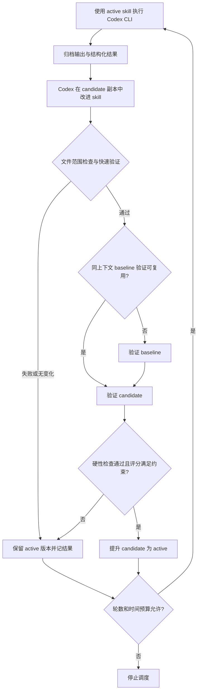

# RSI circle 服务

服务负责运行 Codex CLI、保存过程和结果、让 Codex 修改候选 skill、调度独立验证，并将通过验证的版本交给下一轮。它管理的是版本快照；原始 skill 仓库仍然独立工作。原有 `RUNBOOK.md` 的人工复盘与 PR 发布流程继续可用。

当前交付是一个 Python 3.9+、标准库实现的单机服务，支持 macOS/Linux。离线演示验证调度和版本切换；真实 Day0 的效果必须用实际模型、机器和 canary 验证。一次 fixture 得分提高不能证明真实 skill 改进有效。

## 启动与观察

在仓库根目录运行，无须安装 Python 依赖：

```bash
cd /Users/cx/code/RSI/rsi
python3 -m rsi_service serve --config examples/circle/demo.json
python3 -m rsi_service status --config examples/circle/demo.json
python3 -m rsi_service events --config examples/circle/demo.json
```

演示使用本地故障分类 fixture：原始 notes 将临时资源不足当作致命错误，候选补充一条恢复规则；固定用例检测到分类结果改善后，下一轮使用该候选。最多 3 轮，连续无改动达到限额后停止。它不会调用 Codex、网络、模型权重或 NPU。

查看 `state_dir` 下的状态、每个 job 的 `stdout.log` / `stderr.log`、`context.json`、`output/result.json` 和验证附件，即可追溯一次执行到下一轮使用的版本。Codex 的 stdout 原样保存为 JSONL，stderr 保存诊断；CLI 退出码和 Day0 的业务结果分别判断。

停止调度、取消当前执行、重新接管分别是：

```bash
# 让调度器退出；已启动的长任务继续执行。
python3 -m rsi_service stop --config examples/circle/demo.json

# 显式请求取消当前 job 的本地进程组。
python3 -m rsi_service cancel --config examples/circle/demo.json

# 重启调度器，接管原 job；不会自动从头重跑它。
python3 -m rsi_service serve --config examples/circle/demo.json
```

配置首次启动后固定绑定该 `state_dir`。需要更改任务、验证输入清单、预算或检查器配置时，为新实验选择新的状态目录，并保留旧实验记录；不要通过改配置重置已有实验的预算。已完成的 demo 再次 `serve` 会返回已有终态，需要新实验时使用新的 `state_dir`。

初始化后，查询、停止和取消使用已保存的配置，即使原 skill 或 evaluator 所在挂载失效也能操作。服务重启可先接管正在执行的 worker；后续阶段仍会检查快照和验证输入，缺失时阻塞晋级。

同一个 `state_dir` 只允许一个调度器。不要让多份配置把同一目标仓或同一组 NPU 当作独占资源同时使用；第一版的锁不覆盖跨状态目录、跨主机的资源仲裁。

## 一轮的状态转换



`run` 的 `signed` 只描述这次 Day0 的结果，不能触发版本提升。`aborted` 可以成为改进的证据；`pending` 表示缺输入或授权，需要处理后再继续。CLI 自身出错、缺失结果、工作进程丢失等故障不会被解释为 skill 成功。

候选必须实际产生 allowlist 范围内的文件变化。更改受保护文件、符号链接、伪造通过状态或缺少验证证据都不能替代验证。文件范围检查无法理解全部自然语言语义；独立验证还应检查精度判据、门禁和角色边界没有被削弱。

## 为耗时验证做的取舍

1. **先便宜后昂贵。** 文件差异与 quick 检查失败时不启动完整验证；没有新改动时也不重复验证。
2. **完整验证与调度器分离。** job 由独立 worker 监督；调度器退出后，它继续收集日志、更新心跳并写终态。重新 `serve` 会继续监听这个 job。
3. **只有总时限，没有“无日志即超时”。** 验证可能数小时没有新输出；心跳表明 worker 仍在工作，不能据此推断模型任务取得了进展。
4. **同一时刻只跑一个 job。** 第一版顺序执行 baseline 和 candidate，避免在单套设备上争抢资源。完整验证未结束时不提升版本、不调度下一轮。
5. **精确上下文下复用 baseline。** 缓存绑定 skill 内容、配置、`validation.key`、声明的验证输入及 TTL。TTL 从 worker 实际完成测量时起算，在选用缓存时检查；调度器停机不会刷新它。输入变化、过期或证据失效后重新验证；当前周期中途发现输入改变则阻塞。候选仍需完成独立验证。候选通过后的完整验证记录，在下一轮身份和 TTL 仍满足条件时可作为新 baseline 的缓存。
6. **限制最坏成本。** 每阶段有 `timeouts`；还有限制总运行窗口和循环次数的预算。重启不会重置已有实验的轮数和时间账。
7. **不自动重复不确定任务。** worker 丢失或主机重启后，先保留故障状态，避免同一 Day0 在远端再启动一份。确认本地和远端任务状态后，再用 `recover` 放弃当前未完成周期：

   ```bash
   python3 -m rsi_service recover --config /absolute/path/day0.json
   python3 -m rsi_service serve --config /absolute/path/day0.json
   ```

第一次完整周期可能包含一次 Day0 执行、一次 baseline 验证和一次 candidate 验证，因此应按三个重任务核算初始成本。若已有 run 的实际证据足够，独立 evaluator 可以从 `context.run_job` / `context.previous_result` 读取并核验 baseline 证据，在证明 skill、环境和输入完全一致后复用；服务本身不会把模型的结果摘要自动当成这份证明。

`recover` 的本地 worker 锁检查不能证明远端 SSH、容器或 NPU 作业已经停止。远端 evaluator 应保存作业 ID，使用 cycle/job ID 做幂等键，并提供查询、等待和清理能力。当前版本不支持跨机器迁移运行中的 worker，也不保证任意 CLI 在机器重启后从内部步骤续跑。

要观察一个安静的长验证，可以在启动演示前设置 `RSI_DEMO_EVAL_SECONDS=20`，在 `evaluate` 期间执行 `stop`，稍后重新 `serve`。每个 evaluate job 会等待 20 秒；这只是演示延迟，不代表真实验证成本。

## 接入 Codex CLI 和 Day0

复制 [`codex-day0.example.json`](../examples/circle/codex-day0.example.json)，填入真实路径和任务后启动。模板中的 `/REPLACE_WITH/` 是必填占位符，不能直接用来执行 Day0。

必须准备的输入：

| 配置 | 作用 |
|---|---|
| `workspace` | Codex 执行 Day0 的目标仓库 |
| `skill_source` | 初始 Day0 skill 目录，包含 `SKILL.md` 及相对引用 |
| `state_dir` | 状态、版本、证据与日志；必须与目标仓和源 skill 分离 |
| `task` | 模型、目标阶段、权重、服务器/容器、卡数、验收指标及已有授权 |
| `allowed_paths` / `protected_paths` | 本次可演进文件与不可修改的裁判文件；按实际 Day0 布局逐项指定 |
| `steps.quick` | 独立的低成本检查器 |
| `steps.evaluate` | 真正执行 canary、计算指标并写证据的独立检查器 |
| `validation.key` | 固定的目标代码、模型/数据、NPU、软件镜像、用例矩阵等实验身份 |
| `validation.inputs` | 检查器代码、配置和数据清单等需参与内容指纹的本地文件 |

Codex 适配器使用已核对的 CLI 接口：`codex exec --json --output-schema … -o …`。它把具体快照的 `SKILL.md` 绝对路径放进 prompt，要求相对引用以该快照为准；不依赖全局同名 skill 恰好等于当前版本。`run` 在目标仓执行，`improve` 在候选目录执行，使用 `workspace-write` sandbox；没有开启跳过权限检查的参数。模型和 profile 可在各 step 指定，未指定时使用 CLI 配置。

CLI 需要事先完成登录，真实任务的远程访问和工具授权也应提前配置。服务不修改认证配置；模型请求授权或缺少资源时，应如实报告 `pending`。服务不能使 Day0 自身需要的人工决策自动变得确定。

普通 `command` hook 是受信任的操作员配置，由本地进程直接执行；参数列表不会经过 shell，但它并没有 Codex sandbox 的系统隔离。不要把 agent 生成的 argv 或未经审核的脚本配置为 evaluator。受保护路径与快照检查提供的是演进边界检查，不是对任意恶意本地程序的安全隔离。

官方接口说明：[Codex 非交互执行](https://learn.chatgpt.com/docs/non-interactive-mode)。CLI 参数以部署机器的 `codex exec --help` 为准。

## Hook 和结果契约

每个 hook 收到这些环境变量：

| 变量 | 内容 |
|---|---|
| `RSI_CONTEXT_FILE` | 固定 job 上下文 JSON 路径 |
| `RSI_RESULT_PATH` | 必须写入的 `output/result.json` |
| `RSI_PHASE` | `run` / `improve` / `quick` / `evaluate` |
| `RSI_SKILL_DIR` / `RSI_SKILL_DIGEST` | 本次使用的快照和内容摘要 |
| `RSI_BASELINE_DIR` / `RSI_CANDIDATE_DIR` | 对照和候选目录 |
| `RSI_RUN_DIR` / `RSI_CYCLE_ID` | 当前周期目录及 ID |
| `RSI_VALIDATION_KEY` | 实验环境身份 |

上下文还携带 `evaluation_role` 等阶段信息。命令 `argv` 只替换三个**完整参数**：`{python}`、`{context_file}`、`{result_path}`；没有 shell 展开、命令替换或通用字符串模板。路径配置相对配置文件解析；argv 里的普通相对文件名相对该 step 的 `cwd` 解析。

Codex 的 run 最终结果：

```json
{"outcome":"aborted","summary":"实际观察到的失败原因","evidence":["run-evidence.json"]}
```

improve 的结果只描述修改，服务自己检查实际差异：

```json
{"changed":true,"summary":"根据哪个失败证据，修正了什么知识条目"}
```

quick 检查器示例：

```json
{"passed":true,"evidence":["quick-report.json"]}
```

完整 evaluator 必须返回：

```json
{
  "skill_digest": "从上下文读取的本次 skill 摘要",
  "validation_key": "从上下文读取的实验身份",
  "passed": true,
  "score": 0.85,
  "cases": {"canary-a": 0.9, "canary-b": 0.8},
  "evidence": ["measurements.json", "gate-results.json"]
}
```

证据附件放在 `result.json` 同目录下，使用相对路径；文件必须真实存在。完整评估的分数必须为有限数值，用例名在 baseline/candidate 间一致，数值统一采用**越高越好**的口径。耗时等越低越好的指标可转换成负耗时或固定的收益分数，但 baseline 与 candidate 必须使用同一转换。`passed` 表示全部硬约束（精度、完成度、门禁）通过，不等于收益指标已经改善。

基线也可以是有完整证据的失败测量（`passed: false`），以便修复本来就会失败的 skill；此时检查器正常退出并给出完整的测量、用例与身份。候选必须 `passed: true`。检查器进程异常退出、证据缺失或结果无法解析属于验证故障，不能当成“低分基线”继续晋级。

提升条件包含 candidate 的硬约束通过、`candidate.score >= baseline.score + min_gain`，以及每个用例退化不超过 `max_case_regression`。多个用例的均值改善不能掩盖超限退化。检查器应自己完成足够重复、测量波动判断和必需的置信度判断；服务比较的是检查器给出的最终结果，不会把单次噪声自动变成统计结论。

真实 evaluator 还要保证 baseline/candidate 可比：使用同一固定代码、数据、设备和验收设置，分别创建干净的目标工作区；不能在 baseline 改过的目标仓上直接继续跑 candidate 并把收益归因于 skill。验证任务若需要自行调用 Codex，应同样明确指定 `RSI_SKILL_DIR`，并从真实 gate / tracker / metrics 得出结果。`validation.inputs` 应覆盖检查器依赖；远端镜像、权重和硬件身份需要由 `validation.key` 固定。服务无法仅凭这个字符串自动识别外部环境漂移。

## 长期运行与已有账本

前台 `serve` 本身就是服务进程，可由 systemd、launchd 或已有进程管理器托管。Linux 可参考 [`rsi.service`](../examples/circle/rsi.service)，替换实际用户、路径和 Python。托管器停止主进程时须保留 worker，否则无法获得“服务重启不打断长验证”的行为。

服务状态中的轮次、job 记录、skill 摘要和验证结果构成这一轮实验的可追溯链。第一版不会自动合并外部 skill Git 仓库，不会把 fixture 或模型自述写成 `canaries/validated-versions.md` 的真实 Day0 验证记录，也不会宣称 ≥3 个生产 run 的收益已得到验证。经验证版本的外部 PR 发布，以及与原 `runs/` / `ledger/` 的跨运行收益归因，仍按 `RUNBOOK.md` 的口径完成。
